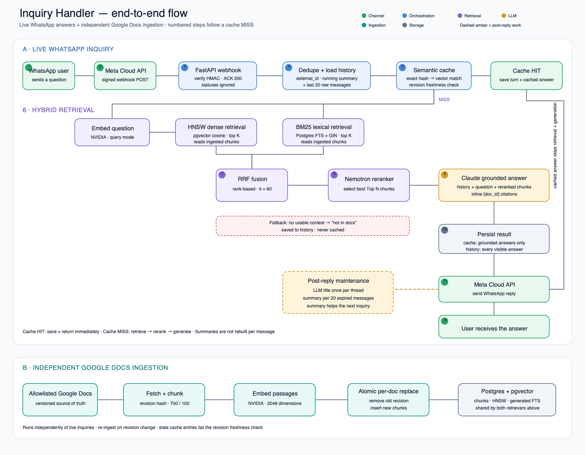

# ARCHITECTURE.md — inquiry-handler

## What it is
Channel-agnostic Inquiry Bot. Adapters (`src/channels/`) normalize inbound messages to `core.handle_inquiry()`, which runs RAG over Google Docs and returns a grounded answer. WhatsApp first; Slack/Telegram later.

## Decisions
- **Postgres + pgvector, not Pinecone.** Multi-turn history needs durable relational tables anyway (`conversation_threads`, `thread_messages`). Keeping vectors in the same Postgres avoids a second system, extra cost, and network hop. Revisit only if vector scale or latency demands it.
- **halfvec(2048), not vector(2048).** pgvector HNSW caps `vector()` at 2000 dims but Nemotron-3-Embed-1B emits 2048. `halfvec` (fp16) allows 4000 dims + HNSW with negligible cosine-recall impact on L2-normalized embeddings; client pin stays `pgvector>=0.3` (custom `HalfVec` column type) because `langchain-postgres` caps the client at `<0.4`. Revisit if pgvector raises the HNSW dim limit or the dep conflict resolves.
- **All RAG under `src/rag/`.** Stages (`ingestion/chunking/embeddings/vectordb/cache/retrieval/reranking/generation`) are children so pipeline ownership is obvious and channels can't import retrieval internals.
- **Regular packages: empty `__init__.py` in every dir under `src/`.** Resolves mypy's duplicate-module collision (`src/channels/whatsapp.py` vs `src/webhooks/whatsapp.py` -> module names anchor as `src.channels.whatsapp` / `src.webhooks.whatsapp`, matching the actual imports) structurally instead of a mypy-config workaround — keeps type checking tool-agnostic going forward. No import or runtime behavior change.
- **Cache before retrieval (`src/rag/cache/`).** Sync `SemanticCache`: Tier-1 exact (`sha256` of normalized query → `query_hash` KV) then Tier-2 semantic (`query_emb` HNSW, hit iff cosine distance ≤ `1 − CACHE_SIM_THRESHOLD`). Freshness is per-entry: an entry is valid only while its `revision_id` is still the only revision its `doc_id` has in `chunks` (per-doc staleness; a caller-passed revision can't be known pre-retrieval in a multi-doc corpus). Returns `CacheHit{query_hash, query_text, answer, citations, revision_id}` — `citations` replay provenance on hits. Never cache "not in docs" fallbacks (`set` refuses blank answers); `set` prunes same-doc rows with a different `revision_id` in the same transaction (invalidate on revision bump).
- **Hybrid retrieval + rerank.** Dense (pgvector cosine) + BM25 fused via RRF, then cross-encoder rerank (`RERANK_TOP_N=4`: 5 chunks diluted ContextualRelevancy to ~0.1 and 3 chunks dropped a fact on multi-part questions; 4 keeps full recall while halving context noise). Pure dense misses IDs/exact terms.
- **Single LLM entry (`src/rag/generation/answer.py`).** RAG-only, low temperature, versioned prompts from `prompts/rag_prompts.yaml` (v1.3.1 — the question-scope rule: answer the asked facts plus key attached conditions, no tips/seller-perspectives tangent; v1.2.0 answers drifted into "free shipping tips" and seller margin content and dropped second facts), citations required, explicit fallback. LangChain `BaseChatModel` factory (`_get_llm`): provider-pluggable via `LLM_PROVIDER` (`anthropic` default → `claude-sonnet-4-6`; `openai` supported) — swap models with zero call-site changes. **LLM secret enforced lazily in `answer.py`** (not a Settings validator) so retrieval/ingest/cache paths run without an LLM key.
- **Citation contract.** Answer text carries user-visible `[doc_id]` markers only (WhatsApp users never see chunk indices); the structured `citations` list carries `doc_id#chunk_index` provenance mapped from retrieval: top-1 reranked chunk per doc the model cited; hallucinated doc refs dropped; zero valid refs → answer still returned with empty citations. Fallback answers are never cached, but are saved to history.
- **Webhook = gate + fast ack + background work (`src/webhooks/`).** Both channels follow one shape: verify trust → 200 immediately → `asyncio.create_task(_process)` (parse → ignore non-text updates → external_id dedupe → `to_thread(handle_inquiry)` → send → `threads.maintain`). Dedupe is check-first (shared idempotency guard `src/webhooks/idempotency.py::external_id_seen`; `thread_messages.external_id` unique index is the backstop; `IntegrityError` = a race loser, rollback of the dupe's turns is intended). Real processing runs in a background task so Meta/Telegram never wait on RAG/LLM latency (ack <20s constraint).  - **WhatsApp** (`/webhooks/whatsapp`): POST verifies `X-Hub-Signature-256` (HMAC-SHA256 of the raw body, key = Meta **App Secret** via `WHATSAPP_APP_SECRET`, enforced lazily in the webhook path like other channel secrets) against `hmac.compare_digest`; only verified payloads are parsed. `statuses` payloads (delivery receipts, incl. error 131031 "Business Account locked" on fresh portfolios) are ACK'd 200 and ignored. GET verify parses Meta's **dot-keyed** query params (`hub.mode`/`hub.verify_token`/`hub.challenge`) — FastAPI named params never see dotted keys.  - **Telegram** (`/webhooks/telegram`): trust = constant-time compare of the `X-Telegram-Bot-Api-Secret-Token` header vs `TELEGRAM_WEBHOOK_SECRET` (the secret registered with `setWebhook`; no GET handshake exists in Bot API). `parse_telegram_payload` keeps only `update.message` with text (edits, callbacks, photos → ignored); `sender_id` is the **chat id** (reply target, group-capable) and `external_id` is the globally-unique `update_id`. `TELEGRAM_BOT_TOKEN` is enforced lazily in `sendMessage` (`/bot<token>/sendMessage`, plain text, no parse_mode).
- **Conversation in `src/conversation/`.** One permanent thread per `(channel, sender_id)` (`wa_id` for WhatsApp); Meta `message.id` dedupe stays in the webhook. `history.load` returns the running summary as a leading system message plus the last 20 raw messages, and `generate_answer` preserves that summary while capping raw history. Both cache hits and misses save their visible turn. `threads.maintain` runs after the reply is sent: it generates an LLM title once per new thread and incrementally summarizes only when at least 20 messages have expired from the raw window (first roll-up at 40 raw messages, then roughly one LLM call per 20 messages, not per save). `summary_timestamp` marks the newest message already covered; raw rows are retained, and failed summaries leave the marker unchanged for retry. `thread_messages.created_at` uses a microsecond offset per user→assistant pair for deterministic ordering.
- **Schema via `scripts/init_db.py` (create_all for fresh DBs) + Alembic.** First schema change (FTS column) arrived with the retrieval slice: `0001_baseline` (empty, matches create_all) + `0002_chunks_fts`. Fresh DBs: `init_db.py` then `alembic stamp head`; schema changes after that = real Alembic revisions.
- **BM25 leg is Postgres FTS, not in-memory.** `chunks.fts` is a `tsvector GENERATED ALWAYS AS (to_tsvector('english', text)) STORED` column + GIN index (`migrations/versions/0002_chunks_fts.py`, mirrored in `Chunk` for fresh create_all). Query via `websearch_to_tsquery` (forgiving of chat input) + `ts_rank`. Generator column self-computes on insert/replace — `atomic_replace` untouched.
- **Reranker: NIM `llama-nemotron-rerank-vl-1b-v2` via LangChain `NVIDIARerank`.** NVIDIA's `integrate.api.nvidia.com` tracked rerank endpoints are EOL (410 Gone, 2026-05-18); the live hosted path embeds the model in the URL, so `RERANK_MODEL` + `RERANK_BASE_URL` settings point at `ai.api.nvidia.com/v1/retrieval/nvidia/llama-nemotron-rerank-vl-1b-v2`. Verified live (200 + correct ordering). Result→chunk mapping is by `metadata["pos"]` tag, not page_content identity (chunk text can repeat across docs).
- **Embeddings via LangChain `NVIDIAEmbeddings` (NIM cloud).** `embed_documents` sends `input_type=passage`, `embed_query` sends `input_type=query` (wrong mode = large accuracy drop); `truncate="END"`, 2048 dims asserted in `src/rag/embeddings/embedder.py`.
- **Chunking is a registry (`src/rag/chunking/chunker.py`).** `Chunker` protocol, default `recursive` (LangChain splitter, 700/100); new strategies register without touching callers; sizes A/B-tested later.
- **Chunk persistence in `src/rag/vectordb/chunks.py`** (entity-named, not `store.py`): `VectorDBInterface` + pgvector impl with atomic per-doc replace; ingest CLI (`src/rag/ingestion/ingest.py`) orchestrates fetch→chunk→embed→replace, `--doc-id` only (no `--all`).
- **DeepEval for evals.** `Golden` (single-turn) / `ConversationalGolden` (multi-turn) + `assert_test`; run via `deepeval test run`, never plain `pytest`. Single-turn goldens live in `evals/goldens/single_turn.json` (native JSON loader — DeepEval 4.2.8 has no YAML one), loaded via `additional_metadata{category, expected_doc_ids, tags}`. Goldens run the real pipeline (hybrid → rerank → `generate_answer`, empty history) with no cache, history, or channel side effects. Judge is a native `AnthropicModel` at temperature 0 — routed through `generation_kwargs={"extra_body": {"temperature": 0}}` because the anthropic SDK ≥1.x removed `temperature` from `messages.create` (still honored server-side). Metric suite: ContextualPrecision 0.7, ContextualRecall 0.8, ContextualRelevancy **0.05** (it scores relevance as a *fraction* of the whole retrieval context — chunk-granularity FAQ retrieval dilutes it to 0.06–0.17 even when retrieval is correct; the floor only catches total noise), Faithfulness 0.9, AnswerRelevancy 0.8, GEval "correctness & completeness" 0.8 anchored so only a missing/contradicted/invented *direct answer* scores below 4/5. Judge metrics run with `DeepEval` `flaky=True` retry to absorb LLM-judge variance — but every case keeps one non-flaky metric (`GEval`) so a verdict is always possible. Out-of-scope goldens are judged as **grounded refusals**: retrieval almost always returns chunks, so the canned `FALLBACK` string only fires on empty retrieval; a refusal that cites what the docs *do* cover (e.g. "crypto is not a listed payment method") passes a non-flaky GEval "Refusal correctness" instead of an exact-match. Deterministic checks (no LLM): expected doc present after rerank + aggregate expected-document MRR; inline `[doc_id]` refs ⊆ retrieved docs; structured citations map to real `doc_id#chunk_index` pairs; grounded answers must carry citations; refusal answers never fabricate. Baseline: 10/10 pass, expected-document MRR 1.0 (~$0.80/run in judge+pipeline API costs, `-n 3`).
- **LangChain by default, LangGraph for branching.** Linear RAG via LCEL chains; stateful/multi-step (rewrite → retrieve → grade → fallback) via LangGraph with Postgres checkpointing. Raw SDK/SQL only with noted reason.
- **`pyproject.toml + uv.lock` canonical.** `uv`-only env. No `requirements.txt`.

## Security
- **Google Docs credentials: service-account key now, keyless at deploy.** Local/Docker dev uses a JSON key (`GOOGLE_SERVICE_ACCOUNT_JSON`, gitignored) for a dedicated SA shared as Viewer only on allowlisted docs — blast radius is limited to those docs. Prefer Workload Identity Federation (or a directly-attached SA on GCP hosts like Cloud Run/GKE) once deployed off-laptop, so no long-lived secret exists; rotate keys every ~90 days while keys persist. Rationale: WIF removes exportable secrets but needs an OIDC issuer + federation plumbing with no natural fit for local Compose.
- **Secrets never committed:** `.env` and `./secrets/` are local-only; `.env.example` holds placeholders. No `os.getenv` outside `src/config.py`.

## User flow



[Editable SVG version](assets/inquiry-handler-flow.svg)

```
User (WhatsApp or Telegram)
  → POST /webhooks/whatsapp (verify X-Hub-Signature-256 vs App Secret; GET verify: dotted hub.* params → hub.challenge as text/plain)
     or POST /webhooks/telegram (verify X-Telegram-Bot-Api-Secret-Token vs TELEGRAM_WEBHOOK_SECRET)
  → 200 {"ok": true} fast; background: statuses/non-text updates → ignored
  → dedupe external_id (check-first SELECT; unique backstop)
  → history.load(wa_id): summary + last 20 raw messages
  → cache.get → HIT? history.save + return
  → MISS: retrieval.hybrid → reranker → answer.py (query + history + context + prompt)
  → cache.set + history.save (user row carries external_id) → channel send API (Graph /messages or Bot API sendMessage)
  → threads.maintain: one-time title + batched summary roll-up
```

## Notes
- WhatsApp constraints: public HTTPS, `messages` field subscription, ack <20s then async work, 24h messaging window, media arrives as `media_id` (5-min URL → fetch immediately).
- **Fresh Meta portfolios: test WABA may be locked (error 131031, "Business Account locked")** — a business-verification gate, not a code issue; clears after BV review. Local testing unaffected: recompute HMAC with the App Secret and curl the running webhook directly.
- Google Docs is versioned source of truth: track `doc_id + revision + chunk_hash`, re-ingest on change.
- **No `revisionId` from the Docs API.** `documents.get` no longer returns one, so `revision_id` is the sha256 of the normalized full text (content-addressed): identical text → identical revision → re-ingest is a no-op; any edit changes the marker and triggers atomic replace + cache invalidation. No Drive scope needed.
